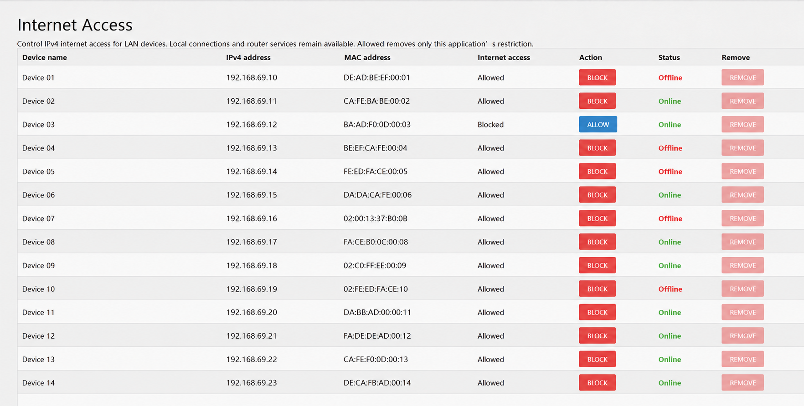

# luci-app-internetblock

Simple IPv4 internet access controls for OpenWrt LAN devices.
Open **Network → Internet Access** to allow or block a device by MAC address.
LAN connections and router DHCP/DNS services remain available.



*Illustrative screenshot: fictional device names, IPv4 addresses and MAC addresses.*

## Devices and Remove

- The list combines static DHCP reservations, DHCP leases, LAN neighbors,
  LAN Wi-Fi stations and its own saved device list. Previously seen devices
  remain visible while offline; static reservations always appear.
- Online means a reachable LAN neighbor or associated LAN Wi-Fi station.
  A DHCP lease alone does not prove a device is online.
- **Block / Allow** saves the device's MAC decision across reboot and firewall
  reload. Allow removes only this application's restriction.
- **Remove** forgets an offline, allowed device without a static reservation.
  It discards the saved name/IP and retains a MAC-only hidden marker, so an old
  lease cannot immediately restore the row. A new active LAN sighting or static
  reservation restores it. Remove never unblocks a device or deletes a reservation.

## Requirements

Tested on **upstream OpenWrt 25.12.5**, GL.iNet Flint 2 / GL-MT6000, with apk,
LuCI and firewall4/nftables. The script package is `noarch`; other targets and
stock GL.iNet firmware are untested.

V1 controls **IPv4 LAN → WAN only**, with firewall zones named `lan` and `wan`.
Guest/VPN zones, routed downstream clients and direct zone-device overrides
are unsupported. Guest leases can appear, but guest clients are not monitored
for liveness. Software/hardware flow offloading must be disabled; the app refuses
new blocks when offload is detected and never changes that setting.

IPv6 is neither blocked nor configured. Changed/spoofed MACs and traffic through
another LAN device can bypass this control. There are no traffic statistics or QoS.

## Install

Back up your configuration. Download the APK and `SHA256SUMS` from
[Releases](https://github.com/Saunakalja/luci-app-internetblock/releases), verify
the checksum and copy the APK to `/tmp/` on the router. Then run:

```sh
apk add --allow-untrusted /tmp/luci-app-internetblock-0.1.0-r8.apk
```

The local APK is unsigned; `--allow-untrusted` bypasses signature verification.
Refresh LuCI and sign in again if needed. Package changes restart rpcd, so an
existing LuCI session may end. Installation needs no router reboot.

## Saved data and removal

`/etc/internetblock/fw4/policy.nft` holds saved blocks and the fw4 fragment;
`/etc/internetblock/seen.json` holds remembered devices and hidden MAC markers.
Access changes and Remove are saved immediately. Changed discovery data is
flushed on first scan, then hourly and on normal service stop; sudden power loss
can lose pending discoveries. There is no traffic history or cloud service.

```sh
apk del luci-app-internetblock
```

Uninstall removes owned runtime/firewall components and retains
`/etc/internetblock/` for recovery or reinstallation. Other OpenWrt settings stay
intact. Stopping the service alone does not prevent saved blocks returning on a
later firewall reload.

## Recovery

With LAN SSH access, clear this application's saved and active blocks:

```sh
/etc/init.d/internetblock stop
/usr/libexec/internetblock reset
/etc/init.d/internetblock start
```

Device memory is retained. If the backend cannot run, use the targeted manual
steps in [development and recovery](docs/DEVELOPMENT.md). Do not flush the entire
nftables ruleset.

## Development

[Build and test instructions](docs/DEVELOPMENT.md) ·
[Validation results](docs/VALIDATION.md) ·
[Report a problem](https://github.com/Saunakalja/luci-app-internetblock/issues)

Include application/OpenWrt versions, router model and the error when reporting
a problem. Remove credentials and private network details from diagnostics.

Licensed under **GPL-3.0-only**; see [LICENSE](LICENSE).
